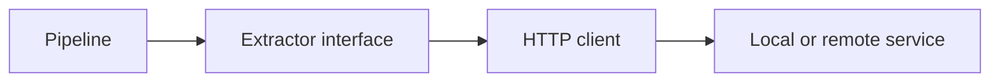

# Extractor Client: First Implementation Specification

## 1. Purpose

Implement the Python client boundary used by Document Lab to send one document image to an extraction service and receive a normalized result.

The client must support a local HTTP service during development and a remote GPU service later without requiring changes to preprocessing, evaluation, validation, or experiment tracking.

This specification covers the client library and its tests. It does not cover implementation of the inference server or any OCR/VLM model.

## 2. Goals

- Define one provider-neutral extraction interface.
- Implement a project-owned HTTP client using `httpx`.
- Support local and remote endpoints through configuration only.
- Preserve the raw server response for experiment artifacts.
- Return normalized text, structured data, layout elements, and telemetry.
- Produce stable, typed, actionable failures.
- Apply bounded retries only when an operation is safe to retry.
- Make every call measurable and traceable with a request ID.
- Test the complete client behavior without a network service or GPU.
- Keep all code, comments, errors, and documentation in English.

## 3. Non-goals

- Hosting PaddleOCR-VL, Ollama, vLLM, or another model.
- Implementing a general plugin system.
- Performing image preprocessing inside the client.
- Evaluating extraction accuracy.
- Validating invoices or EAN values.
- Writing MLflow runs directly from the client.
- Persisting artifacts directly from the client.
- Implementing asynchronous job polling in the first version.
- Supporting batches in one HTTP request.
- Retrying indefinitely or hiding service instability.

## 4. Architectural boundary

The pipeline owns preprocessing, measurement, artifact storage, validation, evaluation, and experiment tracking. The extractor client owns only request construction, transport, response parsing, and normalization.



The pipeline must depend on the extractor protocol, not on `httpx` or a provider SDK.

## 5. Package layout

Use the following structure within the existing `src/document_lab` package:

```text
src/document_lab/extractors/
├── __init__.py
├── base.py
├── errors.py
├── http.py
└── models.py

tests/extractors/
├── test_http_success.py
├── test_http_errors.py
├── test_http_retries.py
└── test_models.py
```

The coding agent may combine small files when that improves clarity, but provider-neutral models and errors must not depend on the HTTP implementation.

## 6. Public Python contract

Use Pydantic v2 models at serialized boundaries. Use `pathlib.Path` for local paths and `Decimal` for business values outside this client.

### 6.1 Extraction request

```python
from pathlib import Path
from typing import Any

from pydantic import BaseModel, Field


class ExtractionRequest(BaseModel):
    document_path: Path
    prompt: str | None = None
    output_schema: dict[str, Any] | None = None
    options: dict[str, Any] = Field(default_factory=dict)
    request_id: str | None = None
```

Requirements:

- `document_path` must exist, be a regular file, and be readable before any network request starts.
- The first implementation must accept JPEG and PNG files.
- MIME type must be detected from the file signature when practical, not trusted solely from the filename.
- An empty prompt is normalized to `None`.
- `output_schema` is an optional JSON Schema requested from capable extractors. The client must not assume the server supports constrained generation unless configured to do so.
- `options` contains service-neutral hints such as language or page number. Do not place credentials in it.
- Generate a UUID request ID when the caller does not supply one.

### 6.2 Document element

```python
class DocumentElement(BaseModel):
    element_type: str
    text: str | None = None
    bounding_box: tuple[float, float, float, float] | None = None
    confidence: float | None = None
    page: int = 1
    metadata: dict[str, Any] = Field(default_factory=dict)
```

Validation rules:

- `element_type` must not be blank.
- `confidence`, when present, must be between `0.0` and `1.0` inclusive.
- `page` is one-based and must be greater than or equal to 1.
- A bounding box uses `(x_min, y_min, x_max, y_max)`.
- Require `x_min <= x_max` and `y_min <= y_max`.
- Coordinates may be pixels or normalized values. The coordinate system must be declared in response metadata when elements are present.

### 6.3 Normalized extraction result

```python
class ExtractionResult(BaseModel):
    text: str = ""
    structured_data: dict[str, Any] = Field(default_factory=dict)
    elements: list[DocumentElement] = Field(default_factory=list)
    metadata: dict[str, Any] = Field(default_factory=dict)
```

Requirements:

- Missing optional provider data becomes an empty collection, not `None`.
- Do not infer or invent fields during transport normalization.
- Unknown response fields must be preserved in the raw response rather than copied automatically into `metadata`.
- Provider-specific values may be placed under a namespaced metadata key, for example `metadata["provider"]`.

### 6.4 Client telemetry

```python
class ExtractionTelemetry(BaseModel):
    request_id: str
    attempts: int
    elapsed_ms: float
    server_processing_ms: float | None = None
    http_status: int
    endpoint_host: str
```

`elapsed_ms` covers the entire client operation, including retries. The pipeline may additionally measure the call externally.

`endpoint_host` must exclude credentials, query strings, and sensitive path data.

### 6.5 Client response

```python
from typing import JsonValue


class ExtractionResponse(BaseModel):
    result: ExtractionResult
    telemetry: ExtractionTelemetry
    raw_response: JsonValue
```

The pipeline uses:

- `result` for validation and evaluation.
- `telemetry` for metrics and diagnostics.
- `raw_response` for the local raw-response artifact.

The raw response must not be logged at `INFO` level.

### 6.6 Extractor protocol

```python
from typing import Protocol


class ExtractorClient(Protocol):
    def extract(self, request: ExtractionRequest) -> ExtractionResponse:
        ...

    def close(self) -> None:
        ...
```

The HTTP implementation must also be usable as a context manager:

```python
with HttpExtractorClient(config) as extractor:
    response = extractor.extract(request)
```

The first public API is synchronous. Do not add a second asynchronous API until a concrete caller requires it.

## 7. HTTP client configuration

Define a validated Pydantic settings model:

```python
class HttpExtractorConfig(BaseModel):
    base_url: str
    extraction_path: str = "/v1/extractions"
    timeout_seconds: float = 300.0
    connect_timeout_seconds: float = 10.0
    max_attempts: int = 2
    retry_backoff_seconds: float = 0.5
    bearer_token_env: str | None = None
    verify_tls: bool = True
    user_agent: str = "document-lab/0.1"
```

Validation requirements:

- `base_url` must use `http` or `https`.
- Permit plain HTTP for loopback/local development.
- Warn when a non-loopback remote endpoint uses plain HTTP.
- Timeouts and backoff values must be positive.
- `max_attempts` must be from 1 through 5.
- `extraction_path` must start with `/`.
- `bearer_token_env` names an environment variable; it never contains the token itself.
- If `bearer_token_env` is configured but absent or blank, fail before sending the request.
- TLS verification defaults to enabled. A disabled value must produce a warning.

Example YAML:

```yaml
extractor:
  type: http
  base_url: http://127.0.0.1:8080
  extraction_path: /v1/extractions
  timeout_seconds: 300
  connect_timeout_seconds: 10
  max_attempts: 2
  retry_backoff_seconds: 0.5
  bearer_token_env: DOCUMENT_EXTRACTOR_TOKEN
  verify_tls: true
```

## 8. HTTP request contract

Send:

```http
POST /v1/extractions
Content-Type: multipart/form-data
Accept: application/json
User-Agent: document-lab/0.1
X-Request-ID: <uuid>
Authorization: Bearer <token>  # only when configured
```

Multipart fields:

| Field | Type | Required | Description |
|---|---|---:|---|
| `document` | File | Yes | JPEG or PNG document bytes |
| `request` | JSON string | Yes | Request metadata and extraction options |

The `request` JSON value must use this shape:

```json
{
  "schema_version": "1",
  "request_id": "a7a1653c-5a20-4c0b-92e1-e5bca09480dc",
  "prompt": null,
  "output_schema": null,
  "options": {
    "language": "es"
  }
}
```

Requirements:

- Stream the file through `httpx` rather than loading it twice into memory.
- Always close the local file handle, including on timeout or exception.
- Do not log the document bytes, bearer token, authorization header, or complete multipart body.
- Reject an unsupported input format before opening a network connection.
- Use `X-Request-ID` for traceability. The same request ID is reused for all retry attempts of one logical extraction.

## 9. HTTP success response contract

The server returns HTTP `200` and JSON:

```json
{
  "schema_version": "1",
  "request_id": "a7a1653c-5a20-4c0b-92e1-e5bca09480dc",
  "result": {
    "text": "Invoice F-2026-001",
    "structured_data": {
      "document_number": "F-2026-001"
    },
    "elements": [],
    "metadata": {
      "model": "paddleocr-vl-1.6",
      "coordinate_system": null
    }
  },
  "processing": {
    "duration_ms": 18342.4
  }
}
```

Client validation requirements:

- `schema_version` must equal a supported version. Initially only `"1"` is supported.
- Response `request_id` must match the sent request ID.
- `result` must validate against `ExtractionResult`.
- `processing.duration_ms` is optional but must be non-negative when present.
- An absent `text`, `structured_data`, or `elements` value may use the normalized defaults.
- A successful response with unknown extra fields must still be accepted and preserved in `raw_response`.
- An invalid success payload raises a response-schema error; it must not be silently converted into an empty result.

## 10. HTTP error response contract

The preferred non-2xx body is:

```json
{
  "error": {
    "code": "unsupported_document",
    "message": "Only JPEG and PNG documents are supported",
    "retryable": false,
    "details": {}
  },
  "request_id": "a7a1653c-5a20-4c0b-92e1-e5bca09480dc"
}
```

The client must tolerate plain-text or malformed error bodies. Preserve only a bounded, sanitized body excerpt in the exception. Limit it to 2 KiB.

## 11. Error model

Define a base exception and specific subclasses:

```python
class ExtractorClientError(Exception):
    request_id: str
    attempts: int
    retryable: bool


class ExtractorConfigurationError(ExtractorClientError): ...
class ExtractorInputError(ExtractorClientError): ...
class ExtractorConnectionError(ExtractorClientError): ...
class ExtractorTimeoutError(ExtractorClientError): ...
class ExtractorHttpError(ExtractorClientError): ...
class ExtractorResponseDecodeError(ExtractorClientError): ...
class ExtractorResponseSchemaError(ExtractorClientError): ...
```

Every exception must provide safe structured context where applicable:

- Request ID.
- Attempt count.
- Error category.
- HTTP status.
- Server error code.
- Whether retrying may succeed.
- Sanitized message.

Exception string representations must never contain a bearer token, complete headers, document bytes, or environment-variable values.

Recommended mapping:

| Condition | Exception |
|---|---|
| Invalid configuration or missing token variable | `ExtractorConfigurationError` |
| Missing, unreadable, empty, or unsupported document | `ExtractorInputError` |
| DNS, refused connection, or transport failure | `ExtractorConnectionError` |
| Connect, write, read, or pool timeout | `ExtractorTimeoutError` |
| Non-2xx status | `ExtractorHttpError` |
| Successful response is not valid JSON | `ExtractorResponseDecodeError` |
| Successful JSON violates the response contract | `ExtractorResponseSchemaError` |

## 12. Retry policy

Retries must be explicit, bounded, and observable.

Retry only:

- Connection failures where no response was received.
- Timeouts.
- HTTP `408`, `429`, `502`, `503`, and `504`.
- Other non-2xx responses only when the server body explicitly sets `retryable` to `true`.

Do not retry:

- Input or configuration errors.
- HTTP `400`, `401`, `403`, `404`, `409`, `413`, `415`, or `422` unless a future contract gives a specific safe reason.
- JSON decoding or success-schema validation failures.
- Any request after `max_attempts` is reached.

Backoff:

- Use exponential backoff based on `retry_backoff_seconds`.
- Add small random jitter.
- Honor a valid `Retry-After` response header for `429` or `503`, capped at 30 seconds.
- Do not sleep after the final attempt.
- Make the sleep function injectable in tests.

Because extraction is logically read-only, retries use the same request ID. The server should treat the request ID as an idempotency key where possible.

## 13. Resource lifecycle

- Reuse one `httpx.Client` across calls made by one `HttpExtractorClient` instance.
- Configure separate connect and overall/read timeouts.
- Implement idempotent `close()`.
- Calling `extract()` after `close()` must raise a clear client error.
- Context-manager exit must close the underlying `httpx.Client` even when extraction fails.
- The client must not create an unbounded background thread or global singleton.
- Support dependency injection of an `httpx.Client` or transport for tests.

## 14. Logging and observability

Use standard Python logging.

At `INFO`, log:

- Request ID.
- Safe endpoint host.
- Attempt number.
- Final status category.
- Total elapsed time.

At `DEBUG`, optionally log:

- Document MIME type and byte size.
- Timeout configuration.
- Response status.
- Retry reason and delay.
- Response schema version.

Never log:

- Image bytes or base64 data.
- Authorization headers or tokens.
- Complete raw responses by default.
- Prompts or structured results at `INFO`.
- Confidential environment variables.

The client does not write MLflow data. It returns telemetry so the pipeline can record metrics centrally.

## 15. Factory integration

Add a small explicit factory used by the pipeline:

```python
def create_extractor(config: ExtractorConfig) -> ExtractorClient:
    match config.type:
        case "http":
            return HttpExtractorClient(config.http)
        case _:
            raise ExtractorConfigurationError(
                f"Unsupported extractor type: {config.type}"
            )
```

Do not use dynamic imports, entry points, reflection, or a plugin framework in the MVP.

If an Ollama-specific adapter is implemented later, it must normalize its response to the same `ExtractionResponse` type.

## 16. Testing requirements

Use `pytest` and either `respx` or `httpx.MockTransport`. The default tests must not use the internet, GPU, Ollama, PaddleOCR, or a real inference server.

### 16.1 Model tests

Test:

- Model defaults do not share mutable state.
- Confidence lower and upper bounds.
- One-based page validation.
- Valid and invalid bounding boxes.
- Missing optional result fields use documented defaults.
- Unsupported response schema version is rejected.
- Response request-ID mismatch is rejected.

### 16.2 Input tests

Test:

- Missing path.
- Directory instead of file.
- Empty file.
- Valid JPEG.
- Valid PNG.
- Unsupported or misleading file extension.
- File handle closes after success and failure.

Use generated synthetic images; do not commit real invoices.

### 16.3 Success tests

Test:

- Correct endpoint and HTTP method.
- Expected multipart field names.
- Request JSON serialization.
- Generated request ID.
- Caller-supplied request ID.
- Optional bearer token.
- No authorization header when token configuration is absent.
- Valid normalized response.
- Unknown response fields retained in `raw_response`.
- Server duration copied to telemetry.
- Safe endpoint host excludes secrets and query data.
- Reuse of one injected HTTP client across calls.

### 16.4 Failure tests

Test:

- Missing configured bearer-token environment variable.
- Connection refused.
- Connect and read timeout.
- Non-JSON success response.
- Malformed JSON success response.
- Invalid success schema.
- Mismatched request ID.
- JSON error body.
- Plain-text error body.
- Error-body excerpt is bounded.
- Secrets are absent from exception messages and captured logs.
- `extract()` after close.

### 16.5 Retry tests

Test:

- Connection failure then success.
- Timeout then success.
- `429` with `Retry-After` then success.
- `503` then success.
- `400` is not retried.
- Invalid success JSON is not retried.
- Maximum attempts are respected.
- The same request ID is used on every attempt.
- No sleep occurs after the final failure.
- Reported attempt count and total elapsed time include retries.

### 16.6 Pipeline contract test

Provide a fake implementation of `ExtractorClient` and prove that the document pipeline can run without importing `httpx` or provider-specific code.

## 17. Acceptance criteria

The implementation is complete when:

- Public models and the extractor protocol are typed and documented.
- A valid JPEG or PNG can be sent using the specified multipart contract.
- The server response is validated and normalized into `ExtractionResponse`.
- Raw JSON is available to the pipeline for artifact storage.
- Request and server timing are available through telemetry.
- Local and remote endpoints require configuration changes only.
- Bearer authentication is sourced from an environment variable and never logged.
- All network calls use explicit timeouts.
- Retry behavior matches this specification and is fully tested.
- All documented error categories are implemented with safe context.
- Client and file resources close correctly on every path.
- The factory selects the HTTP implementation without dynamic plugin machinery.
- The default tests require no external service, network, or GPU.
- Ruff, mypy, and pytest pass.

## 18. Verification commands

The coding agent must run:

```bash
uv run ruff check src/document_lab/extractors tests/extractors
uv run ruff format --check src/document_lab/extractors tests/extractors
uv run mypy src/document_lab/extractors
uv run pytest tests/extractors
```

Then run the repository-wide checks defined in the main implementation specification.

## 19. Ordered implementation plan

1. Add provider-neutral request, result, response, telemetry, and element models.
2. Add the extractor protocol and structured exception hierarchy.
3. Add validated HTTP configuration and secret resolution.
4. Implement local input validation and MIME detection.
5. Implement one-attempt request construction and response parsing.
6. Add resource lifecycle and context-manager behavior.
7. Add the bounded retry policy with injectable sleep and jitter.
8. Add safe logging and telemetry.
9. Add the explicit extractor factory.
10. Add unit tests for models, success, errors, retries, and resource cleanup.
11. Add a fake-client pipeline contract test.
12. Run scoped and repository-wide verification commands.

## 20. Deferred extensions

Keep these possible without implementing them now:

- Async extraction and concurrent benchmarking.
- Job submission plus status polling for serverless GPU cold starts.
- Multiple pages or PDF upload.
- Streaming upload progress.
- Provider-specific adapters for Ollama and commercial document APIs.
- mTLS or signed-request authentication.
- Circuit breaking and rate limiting.
- Batch extraction.
- Server capability discovery.

Do not introduce abstractions solely for these deferred features in the first implementation.
